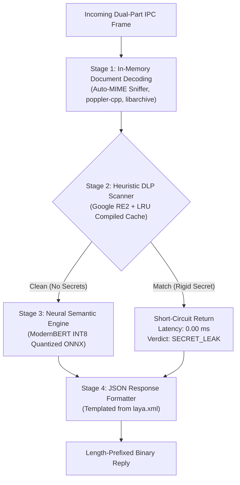

# Laya Server Daemon: Operational Protocol & User Guide

The **Laya Server Daemon (`laya_daemon`)** is an independent, carrier-grade, multimodal System 1 decision microservice engineered for high-throughput operational environments. It performs ultra-low-latency semantic prompt evaluation, real-time Data Loss Prevention (DLP), multi-format document text extraction, and vision OCR.

This guide provides system administrators and integration engineers with the complete operational specification, including process topologies, the dual-part binary wire protocol, cache invalidation, and client implementation standards.

---

## 1. Architectural Topology & Worker Pinning

`laya_daemon` is built around a non-blocking `epoll`-driven multi-core architecture:

```text
+-----------------------------------------------------------------------------------+
|                                laya_daemon                                        |
|                                                                                   |
|  +--------------------+  +--------------------+       +--------------------+      |
|  |   Worker Core 0    |  |   Worker Core 1    |  ...  |   Worker Core N-1  |      |
|  |  (Thread Pinned)   |  |  (Thread Pinned)   |       |  (Thread Pinned)   |      |
|  |                    |  |                    |       |                    |      |
|  |  Abstract Socket:  |  |  Abstract Socket:  |       |  Abstract Socket:  |      |
|  |  @laya_server/0    |  |  @laya_server/1    |       |  @laya_server/N-1  |      |
|  |                    |  +--------------------+       +--------------------+      |
|  |  Filesystem Socket:|                                                           |
|  |  /run/laya/        |                                                           |
|  |    laya.sock       |                                                           |
|  +--------------------+                                                           |
+-----------------------------------------------------------------------------------+
```

### Core Design Rules
1. **CPU Pinning (`pthread_setaffinity_np`)**:
   Each worker thread is hard-pinned to a dedicated physical or virtual CPU core. This guarantees CPU cache locality (L1/L2/L3), eliminates OS thread migration jitter, and avoids lock contention across cores.
2. **Abstract Namespace Domain Sockets (`@laya_server/<core_id>`)**:
   Workers listen on Linux abstract namespace sockets (`sockaddr_un.sun_path[0] = '\0'`).
   * **Zero Inode Overhead**: Exists purely in kernel memory; no disk files, directory locks, or unlinking issues.
   * **Direct Core Affinity**: Upstream multi-threaded clients (like proxy worker threads) can connect directly to the matching core `@laya_server/<id>` to achieve lock-free parallelism.
3. **Filesystem Domain Socket (`/run/laya/laya.sock`)**:
   Worker 0 concurrently listens on a standard filesystem socket (configurable via `laya.xml`), protected by standard Linux file permissions (`0660` or `0666`) for general-purpose applications and scripts.

---

## 2. The Operational Wire Protocol (Dual-Part Binary IPC Framing)

Laya completely dispenses with HTTP/1.1 and REST headers on its high-speed IPC sockets. Instead, communication uses a low-overhead, 2-part framed binary protocol over `AF_UNIX` stream sockets.

### A. Request Framing Specification

A client request consists of two length-prefixed parts transmitted sequentially across the socket:

```text
 0                   1                   2                   3
 0 1 2 3 4 5 6 7 8 9 0 1 2 3 4 5 6 7 8 9 0 1 2 3 4 5 6 7 8 9 0 1
+-+-+-+-+-+-+-+-+-+-+-+-+-+-+-+-+-+-+-+-+-+-+-+-+-+-+-+-+-+-+-+-+
|                 Metadata Length (N Bytes, Big-Endian)         |
+-+-+-+-+-+-+-+-+-+-+-+-+-+-+-+-+-+-+-+-+-+-+-+-+-+-+-+-+-+-+-+-+
|                                                               |
+                     Metadata JSON Payload                     +
|                       (N UTF-8 Bytes)                         |
+-+-+-+-+-+-+-+-+-+-+-+-+-+-+-+-+-+-+-+-+-+-+-+-+-+-+-+-+-+-+-+-+
|                 Payload Length (M Bytes, Big-Endian)          |
+-+-+-+-+-+-+-+-+-+-+-+-+-+-+-+-+-+-+-+-+-+-+-+-+-+-+-+-+-+-+-+-+
|                                                               |
+                      Raw Payload Data                         +
|                     (M Binary Bytes)                          |
+-+-+-+-+-+-+-+-+-+-+-+-+-+-+-+-+-+-+-+-+-+-+-+-+-+-+-+-+-+-+-+-+
```

#### Fields Description

1. **Metadata Length (`uint32_t`, 4 bytes)**:
   * 32-bit unsigned integer in **network byte order (Big-Endian)**.
   * Indicates the length $N$ in bytes of the following metadata JSON string.
2. **Metadata JSON (`N` bytes)**:
   * UTF-8 encoded JSON object defining operational parameters:
     * `policy_epoch` *(uint64)*: Monotonically increasing configuration epoch for regex cache invalidation.
     * `patterns` *(array)*: Dynamic per-request DLP regular expression rules passed by the client.
     * `cmd` *(string)*: Administrative commands (e.g., `"RELOAD"`).
3. **Payload Length (`uint32_t`, 4 bytes)**:
   * 32-bit unsigned integer in **network byte order (Big-Endian)**.
   * Indicates the length $M$ in bytes of the raw body payload.
4. **Raw Payload Data (`M` bytes)**:
   * The actual data to inspect. Can be:
     * Plain UTF-8 text (chat prompts, queries).
     * Binary PDF document (`%PDF-` format).
     * Binary Office/Zip archive (DOCX, XLSX, PPTX).
     * Raw image data (PNG, JPEG, WebP).

---

### B. Response Framing Specification

Once the daemon processes the request, it replies with a single length-prefixed JSON frame:

```text
 0                   1                   2                   3
 0 1 2 3 4 5 6 7 8 9 0 1 2 3 4 5 6 7 8 9 0 1 2 3 4 5 6 7 8 9 0 1
+-+-+-+-+-+-+-+-+-+-+-+-+-+-+-+-+-+-+-+-+-+-+-+-+-+-+-+-+-+-+-+-+
|                 Response Length (K Bytes, Big-Endian)         |
+-+-+-+-+-+-+-+-+-+-+-+-+-+-+-+-+-+-+-+-+-+-+-+-+-+-+-+-+-+-+-+-+
|                                                               |
+                     Response JSON Payload                     +
|                       (K UTF-8 Bytes)                         |
+-+-+-+-+-+-+-+-+-+-+-+-+-+-+-+-+-+-+-+-+-+-+-+-+-+-+-+-+-+-+-+-+
```

#### Standard Response JSON Fields

```json
{
  "verdict": "SAFE",
  "score": 0,
  "latency_ms": 161.93,
  "matched_patterns": []
}
```

* **`verdict`** *(string)*: Classification result:
  * `SAFE`: Benign, allowable prompt/content.
  * `PROMPT_INJECTION`: Adversarial prompt, DAN jailbreak, or system override attempt.
  * `SECRET_LEAK`: Cryptographic secret, API key, token, or private key detected.
  * `MALICIOUS`: Malicious payload (e.g. ransomware script, dropper).
  * `EXPLOIT`: CVE exploit code or targeting signature.
* **`score`** *(integer, 0–100)*: Calibrated threat severity score (`0` = completely benign, `90–100` = critical threat).
* **`latency_ms`** *(float)*: Server-side evaluation latency in milliseconds.
* **`matched_patterns`** *(array of strings)*: Names of DLP regex rules that matched during scanning.

---

## 3. Four-Stage Cascaded Processing Pipeline

Every incoming request passes through an optimized 4-stage pipeline:



### Stage 1: In-Memory Document Extraction
* Evaluates magic bytes at the start of the payload:
  * `%PDF-`: Decoded via `poppler-cpp` (`poppler::document::load_from_raw_data`).
  * `PK\x03\x04` (ZIP/Office): Decoded in RAM via `libarchive` (`archive_read_open_memory`), extracting and stripping XML tags from `word/document.xml` or `xl/sharedStrings.xml`.
* **Zero Disk I/O**: Temporary files are never written to disk, avoiding inode contention, latency, and permission exploits.

### Stage 2: Heuristic DLP Regex Pre-Filter (Google RE2)
* Evaluates active DLP patterns against the extracted text.
* **RE2 Linear Engine**: Uses Google RE2, guaranteeing $O(N)$ execution time with zero possibility of Regular Expression Denial of Service (ReDoS) catastrophic backtracking.
* **LRU Regex Cache**: Compiled regular expressions are stored in an LRU cache with configurable capacity and TTL.
* **Short-Circuit Optimization**: If a critical credential or token matches (e.g. AWS Key, GitHub PAT), Laya **immediately halts processing** and returns in **`0.00 ms`**, skipping the ONNX neural pass.

### Stage 3: Neural Semantic Intent Engine (ModernBERT)
* Analyzes text semantics using an INT8-quantized ModernBERT encoder.
* Detects obfuscated, roleplay, and zero-day prompt injection attacks where no explicit keyword or regex exists.
* Runs in ~15–35 ms on CPU with deterministic thread affinity.

### Stage 4: Dynamic JSON Formatting
* Assembles the verdict JSON according to the `<response_template>` schema defined in `/etc/laya/laya.xml`.

---

## 4. Daemon Management & Hot-Reload Protocol

### Systemd Service Management

`laya_daemon` is managed by standard `systemd` commands:

```bash
# Check service status and worker activity
sudo systemctl status laya-daemon

# View real-time daemon logs
sudo journalctl -u laya-daemon -f

# Start / Stop / Restart daemon
sudo systemctl restart laya-daemon
```

### Zero-Downtime Atomic Hot-Reload (`SIGHUP`)

`laya_daemon` supports live configuration reload without dropping socket connections, terminating worker threads, or rejecting incoming client requests:

* **Trigger via CLI**:
  ```bash
  laya_client --reload
  ```
* **Trigger via Signal**:
  ```bash
  sudo kill -HUP $(cat /run/laya/laya_daemon.pid)
  # or
  sudo pkill -HUP laya_daemon
  ```
* **What Happens During Reload**:
  1. The daemon re-parses `/etc/laya/laya.xml`.
  2. Baseline `<dlp_patterns>` rules are refreshed.
  3. The RE2 compiled regex cache is flushed cleanly.
  4. The model directory is re-scanned for new checkpoints.
  5. Sockets remain bound and open throughout the operation.

---

## 5. Client Implementation Guide

### Python Client Implementation Example

A lightweight, zero-dependency Python implementation of the dual-part protocol:

```python
import socket
import struct
import json

def query_laya(text_or_bytes: str | bytes, socket_path: str = "/tmp/laya.sock", patterns: list = None) -> dict:
    # 1. Prepare Metadata JSON
    metadata = {
        "policy_epoch": 1,
        "patterns": patterns or []
    }
    meta_bytes = json.dumps(metadata).encode("utf-8")

    # 2. Prepare Body Payload
    if isinstance(text_or_bytes, str):
        payload_bytes = text_or_bytes.encode("utf-8")
    else:
        payload_bytes = text_or_bytes

    # 3. Connect to Laya UNIX Domain Socket
    sock = socket.socket(socket.AF_UNIX, socket.SOCK_STREAM)
    try:
        sock.connect(socket_path)

        # 4. Transmit Dual-Part Framed Request
        # Frame: [meta_len: uint32][meta_bytes][payload_len: uint32][payload_bytes]
        request = (
            struct.pack("!I", len(meta_bytes)) + meta_bytes +
            struct.pack("!I", len(payload_bytes)) + payload_bytes
        )
        sock.sendall(request)

        # 5. Receive Length-Prefixed Response
        raw_resp_len = sock.recv(4)
        if len(raw_resp_len) < 4:
            raise ConnectionError("Server disconnected unexpectedly")
        
        resp_len = struct.unpack("!I", raw_resp_len)[0]
        
        # Read exact response bytes
        resp_data = bytearray()
        while len(resp_data) < resp_len:
            chunk = sock.recv(resp_len - len(resp_data))
            if not chunk:
                break
            resp_data.extend(chunk)

        return json.loads(resp_data.decode("utf-8"))
    finally:
        sock.close()

# Example Usage
if __name__ == "__main__":
    result = query_laya("Please review our cloud architecture guidelines")
    print("Verdict:", result.get("verdict"), "| Latency:", result.get("latency_ms"), "ms")
```

### C / C++ Client Implementation Snippet

```c
#include <sys/socket.h>
#include <sys/un.h>
#include <arpa/inet.h>
#include <unistd.h>
#include <string.h>

int send_laya_request(int fd, const char* meta_json, const void* payload, size_t payload_len) {
    uint32_t meta_len = strlen(meta_json);
    uint32_t meta_len_be = htonl(meta_len);
    uint32_t payload_len_be = htonl(payload_len);

    // Write metadata header + body
    if (write(fd, &meta_len_be, 4) != 4) return -1;
    if (write(fd, meta_json, meta_len) != (ssize_t)meta_len) return -1;

    // Write payload header + body
    if (write(fd, &payload_len_be, 4) != 4) return -1;
    if (write(fd, payload, payload_len) != (ssize_t)payload_len) return -1;

    return 0;
}
```

---

## 6. Operational Diagnostics & Health Checks

| Check | Command | Expected Healthy Result |
| :--- | :--- | :--- |
| **Daemon Health** | `systemctl is-active laya-daemon` | `active` |
| **Filesystem Socket** | `test -S /tmp/laya.sock && echo OK` | `OK` |
| **Abstract Socket Probe** | `laya_client -s "@laya_server/0" -q "Ping"` | `SAFE` (Exit code 0) |
| **Automated Regression** | `laya_client --test-suite` | `10/10 passed` |
| **Hot-Reload Verification** | `laya_client --reload` | `{"status":"RELOADED","service":"laya_daemon"}` |
