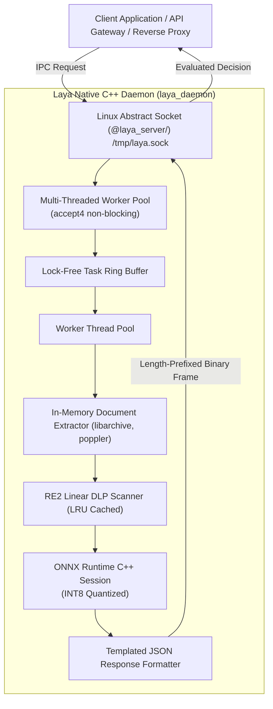

# Implementation Plan: Building, Testing, and Distributing Laya Daemon

## Goal & Architecture Overview

Establish an enterprise-grade pipeline to **build, test, and distribute** the Laya AI (`https://laya-ai.com/`) System 1 decision engine as an independent, standalone Linux daemon.

This architecture implements a **pure C++20** implementation (strictly zero Python) adhering to carrier-grade documentation and performance standards:
1. **Build**: A lightweight, crash-isolated daemon (`laya_daemon`) running INT8/FP16 quantized ModernBERT weights over in-memory **Linux Abstract Namespace Sockets** (`@laya_server/<cpu>`) and `/tmp/laya.sock`.
2. **Deterministic Latency**: Guarantees bounded inference times (~15–35 ms on CPU) with non-autoregressive output (zero hallucination).
3. **Documentation Standard**: Full Doxygen annotations (`@file`, `@brief`, `@param`, `@return`, `@note Thread-Safety`) across all C++ headers and source implementations.
4. **Automated Testing**: Dedicated regression test suite (`./laya_client --test-suite`) verifying benign vs prompt-injection vs DLP secret leaks with automated pass/fail assertions.
5. **Distribute**: Seamless packaging into standalone Debian `.deb` packages with systemd unit service (`laya-daemon.service`).

---

## Architectural Specification



---

## Component Breakdown

### Component 1: `laya_daemon` Pure C++ Daemon
A standalone C++20 daemon running on Linux (Debian 13) that listens on abstract sockets `@laya_server/<cpu>` and `/tmp/laya.sock`.

#### `laya_daemon.cpp`
- **Listener Threads**: Binds `@laya_server/<cpu>` using `sockaddr_un` with leading `\0` (pure in-memory socket, zero filesystem inode). Runs `accept4(listen_fd, ..., SOCK_CLOEXEC)`.
- **Inference Pipeline**: Runs ONNX Runtime with quantized model weights (`model_quantized.onnx`).
- **Configuration Management**: Hot-reloads runtime configuration from `laya.xml` via `SIGHUP` or IPC `--reload` command.

#### Packaging: `laya-daemon.service`
```ini
[Unit]
Description=Laya AI Multimodal Decision Daemon
After=network.target

[Service]
Type=simple
ExecStart=/usr/local/bin/laya_daemon --config /etc/laya/laya.xml
ExecReload=/bin/kill -HUP $MAINPID
Restart=always
RestartSec=3
LimitNOFILE=65536

[Install]
WantedBy=multi-user.target
```

---

## Phase Breakdown & Validation Pipeline

### Phase 1: Local Daemon Compilation & Verification
1. Compile daemon with embedded static TinyXML2, Google RE2, and libarchive:
   ```bash
   make clean && make -j$(nproc)
   ```
2. Launch daemon with active configuration:
   ```bash
   ./laya_daemon --config laya.xml
   ```
3. Run comprehensive regression test suite:
   ```bash
   ./laya_client --test-suite
   ```

### Phase 2: Performance Benchmarking
1. Multi-threaded concurrency benchmark:
   ```bash
   ./benchmark_client
   ```
2. Per-core cache locality and lock-free throughput benchmark:
   ```bash
   ./benchmark_per_core
   ```

### Phase 3: Standalone Debian Packaging
1. Generate Debian package structure:
   - Binary: `/usr/local/bin/laya_daemon` and `/usr/local/bin/laya_client`
   - Config: `/etc/laya/laya.xml` and `/etc/laya/laya_section.xml`
   - Systemd: `/etc/systemd/system/laya-daemon.service`
2. Build `.deb` package via `dpkg-deb --build`.
