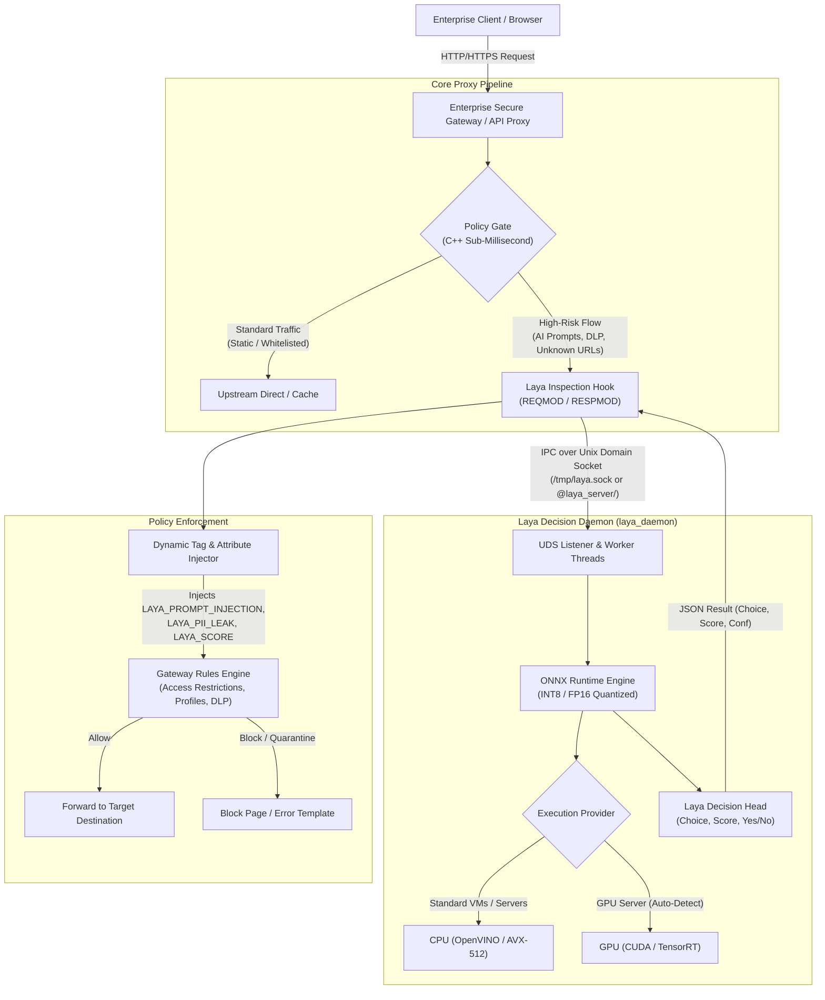

# Architectural Blueprint: Laya AI Integration with Enterprise Secure Gateways

## Executive Summary & Verdict

**Verdict: Deploying Laya AI (`https://laya-ai.com/`) as an independent System 1 decision microservice is an exceptionally sound architectural decision**, providing a **selective, policy-gated sidecar pipeline** rather than evaluating every raw HTTP packet synchronously.

Core proxy engines excel at high-throughput, low-latency C/C++ proxying and regex/MIME-based filtering. Their primary competitive gap in modern enterprise security is **GenAI security, prompt-injection defense, and semantic DLP**. Traditional generative LLMs (like GPT-4 or Claude) are unusable inline because of their 500ms–2000ms latency, high cost, and potential for hallucinations. 

**Laya AI** resolves this dilemma:
- **Non-Autoregressive System 1 Architecture**: Evaluates state and typed questions in a single bidirectional encoder pass (ModernBERT-large, ~421M parameters).
- **Predictable, Fast Latency**: Completes inferences in **~15–35 ms** on modern CPUs (or ~5–12 ms on GPUs).
- **Structured Decisions Without Hallucination**: Directly outputs calibrated probabilities across discrete choices, continuous scores, and boolean flags.
- **Data Sovereignty & Local Execution**: Fully open-weights (Apache 2.0), enabling local on-premise execution without sending sensitive enterprise traffic outside the security perimeter.

---

## Architectural Specification

---

## Key Design Decisions

### 1. Selective Policy-Gated Scheduling
* Gateways process thousands of concurrent requests per second at sub-millisecond latencies.
* Laya will **not** be invoked for static resources, CDNs, media streams, or known benign domains.
* **Trigger Conditions**:
  1. **GenAI Outbound Prompts**: HTTP `POST` requests to generative AI endpoints (e.g., `api.openai.com`, `claude.ai`, `copilot.microsoft.com`, `chatgpt.com`).
  2. **DLP Inspection**: Uploads and form submissions exceeding confidence thresholds in initial regex/OCR passes.
  3. **Zero-Day / Uncategorized URLs**: Inbound web text when URL classification feeds return *Unknown* or *Suspicious*.

### 2. Phased Interface Architecture: Standalone Daemon to Embedded ONNX
* **Phase 1 (Recommended & Approved)**: Standalone daemon (`laya_daemon`) communicating with client applications over a high-speed Unix Domain Socket (`/tmp/laya.sock` or `@laya_server/<cpu>`).
  * **Process & Crash Isolation**: A memory surge, tensor exception, or crash in the neural process will never terminate the core proxy or client application.
  * **Independent Lifecycle**: Model weights and daemon updates occur independently of host gateway releases.
  * **Concurrency**: Multi-threaded per-core abstract sockets eliminate lock contention and dynamic CPU affinity switching overhead.
* **Phase 2 (Contingent)**: If benchmarking demonstrates that IPC serialization adds intolerable overhead (>2ms), migrate the hook into an in-process C++ module embedding `libonnxruntime.so`.

### 3. Compute Profile & Hybrid Hardware Target
* **Model Checkpoint**: ModernBERT-large backbone (~421M parameters).
* **Quantization**: INT8 quantized weights (~420 MB RAM footprint).
* **Execution Strategy**:
  * **Default Target (95%+ deployments)**: Multi-threaded CPU execution utilizing ONNX Runtime / OpenVINO with AVX-512 / VNNI instruction sets. Fits standard VMware, Proxmox, and KVM virtual appliances.
  * **Auto-Acceleration**: Automatically initializes CUDA / TensorRT execution providers if an NVIDIA GPU is detected during daemon startup.

### 4. Policy Engine & Tagging Integration
* Laya does not replace the client gateway's rule engine; it enriches it.
* **Dynamic Tags**: Laya publishes structured attributes into the transaction context:
  * `TAG_LAYA_PROMPT_INJECTION`
  * `TAG_LAYA_PII_LEAK`
  * `TAG_LAYA_THREAT_MALICIOUS`
  * `LAYA_RISK_SCORE` (normalized integer 0–100)
* **Configuration**: Host policies evaluate these tags with standard Boolean logic to trigger actions: `ALLOW`, `DENY`, `REDIRECT`, or `QUARANTINE`.

### 5. Failure Resilience & Graceful Degradation
* **Timeout Threshold**: Fixed hard timeout of **75 ms**.
* **Failure Handling**:
  * If the daemon is unreachable, times out, or returns an error, the request is stamped with `TAG_LAYA_SCAN_FAILED` / `TAG_LAYA_BYPASS_TIMEOUT`.
  * **Graceful Fallback**: General user web browsing continues uninterrupted (fail-open) while falling back to traditional static signatures.
  * **High-Security Policies**: Administrators can configure explicit fail-closed rules for restricted profiles (e.g., `IF TAG_LAYA_SCAN_FAILED AND PROFILE_FINANCE THEN BLOCK`).

### 6. Model Maintenance & Checkpoints
* **Pre-Packaged Checkpoints**: Pre-quantized cybersecurity checkpoints (`laya-cybersec.onnx`) can be distributed alongside model directories.
* **Custom Schemas**: Administrators can define custom question schemas and label enumerations in Laya's XML configuration without retraining the underlying model weights.

---

## Implementation Roadmap

| Phase | Milestone | Primary Deliverable | Success Criteria |
| :--- | :--- | :--- | :--- |
| **Phase 1** | **Sidecar & Latency Benchmark** | Standalone `laya_daemon` with INT8 ONNX weights and UDS interface. | Latency < 35ms on CPU; zero impact on proxy uptime during simulated crashes. |
| **Phase 2** | **C++ Client Hook** | C++ IPC client library for upstream proxies and applications. | Selective interception of GenAI POST prompts; tagging verified in access logs. |
| **Phase 3** | **Schema & WebUI Integration** | XML schema additions (`laya_section.xml`) and WebUI rule editor. | Admins can configure Laya thresholds and actions declaratively. |
| **Phase 4** | **Packaging & Release Pipeline** | Integration into standalone Debian packaging and appliance deployment. | Clean deployment via standard package updates. |
